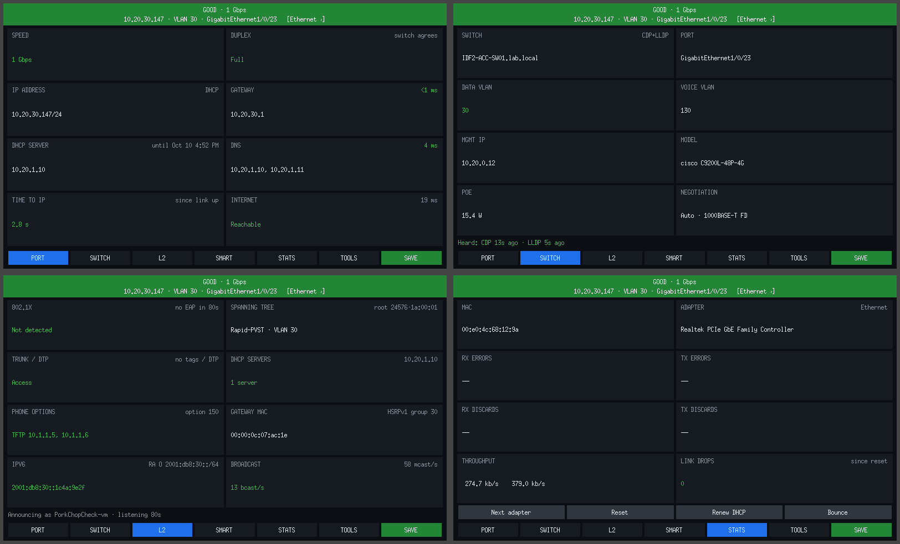
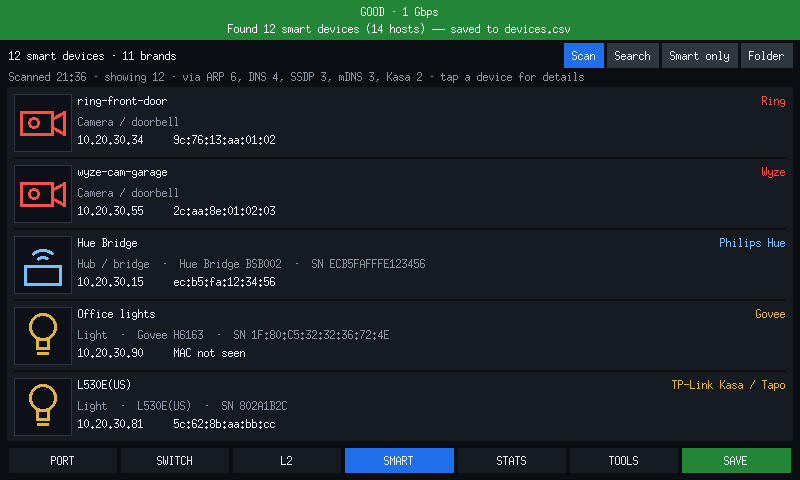
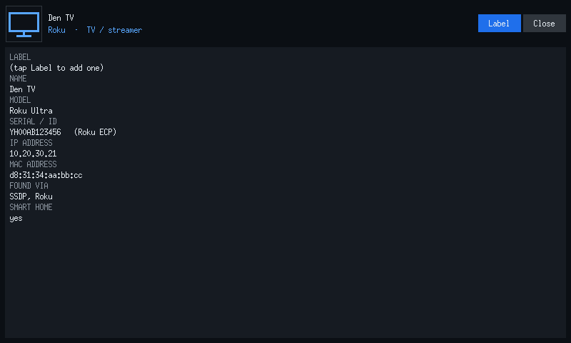
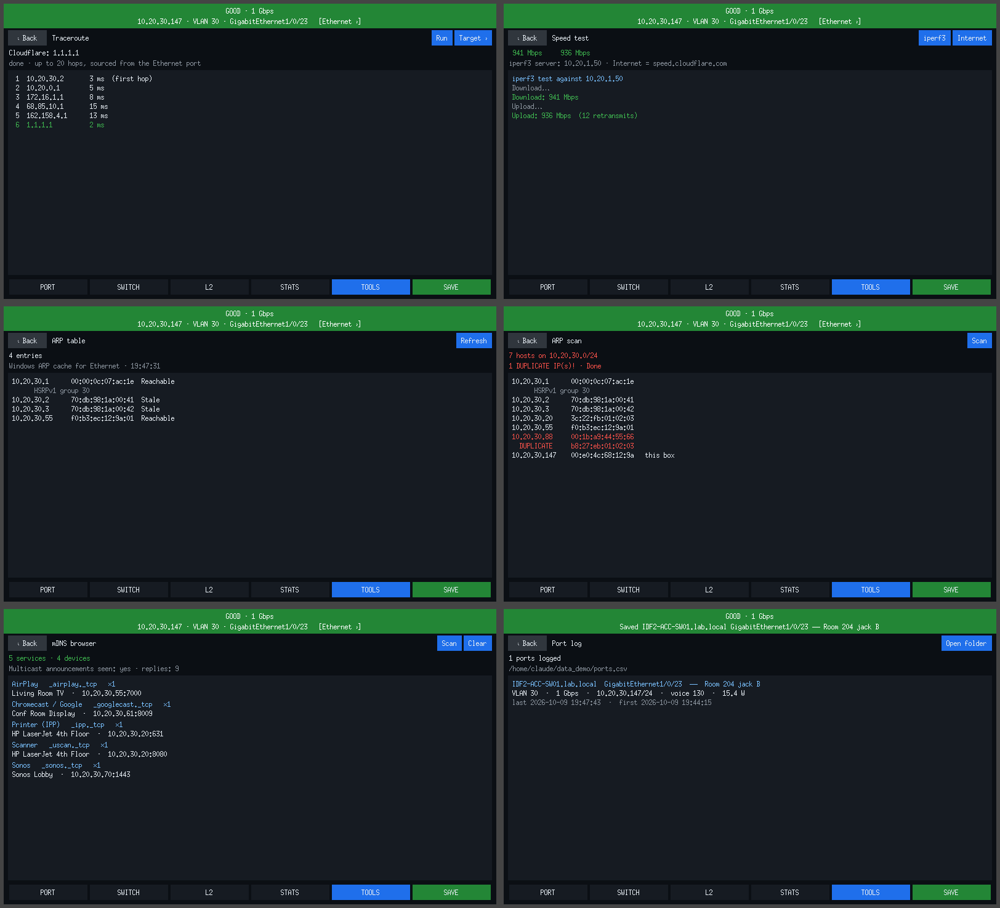
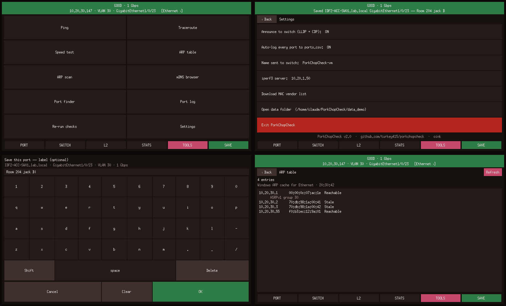

# PorkChopCheck 🐷

A great tool to check your network and ports on your network. CDP, LLDP, and so much more.

Full-screen, big-text, touch-friendly switch-port tester. Plug it into a jack and it tells you what's on the other end. It runs on **Windows 10/11** and **Linux (Nobara, Fedora, Ubuntu)** from the same code.

## Download

Grab the latest build from **[Releases](https://github.com/turkey415/porkchopcheck/releases)**:

| File | For |
|---|---|
| `PorkChopCheck-<version>-windows-exe.zip` | Windows, easiest. One `.exe`, no Python needed. Install [Npcap](https://npcap.com) first. |
| `PorkChopCheck-<version>-windows-python.zip` | Windows, if you'd rather run the Python source |
| `PorkChopCheck-<version>-linux.tar.gz` | Nobara / Fedora / Ubuntu |

## Windows setup

**The .exe:**
1. Install Npcap from npcap.org, keeping the defaults.
2. Unzip the exe zip anywhere and run `PorkChopCheck.exe`. It asks for admin once, then opens fullscreen.

**From source:**
1. Install Python 3.12 or newer, and Npcap.
2. In a terminal in the unzipped folder, run `py -m pip install -r requirements.txt`.
3. Double-click `porkchopcheck.py` or `PorkChopCheck.bat`.

If it won't start, the error is saved to `crash.log` in the same folder and shown in a pop-up.

## Linux setup (Nobara / Fedora)

```bash
tar xzf PorkChopCheck-*-linux.tar.gz
cd PorkChopCheck-*-linux
./install-linux.sh
```

Then launch **PorkChopCheck** from the app menu, or run `porkchopcheck`. On a small touchscreen, use `porkchopcheck --fullscreen`.

The installer uses `dnf` to add Tk, libpcap, iproute, ethtool, a C compiler, and iperf3. It copies the app to `/opt/porkchopcheck`, owned by root, and builds a small launcher there. *Only that launcher* gets permission to capture packets and bring the link up and down, and all it can do is start PorkChopCheck. You never run the app as root. To remove it, run `./install-linux.sh --uninstall`.

Your port log, device inventory and settings live in `~/Documents/PorkChopCheck/data`. If you are upgrading from a beta that kept them next to the app, the installer copies them across.

**Upgrading from v2.0.0-beta.1 to beta.4:** those versions gave the capture permission to a Python interpreter inside the unpacked folder, which any program on the machine could run. Running the new `./install-linux.sh` removes that permission from the old copies it finds. You can then delete the old `PorkChopCheck-*-linux` folders.

On Linux the app reads link and IP details from `/sys`, `ip`, and NetworkManager (`nmcli`). Linux drivers usually pass VLAN tags and LLDP frames through, so trunk and LLDP detection tend to work even better than on Windows.

## Pages

Swipe left/right or tap the bottom bar to move between pages.

| Page | What it shows |
|---|---|
| **PORT** | Speed, duplex (checked against the switch), IP, gateway ping, DHCP server and lease, DNS, time-to-IP (flags portfast off), internet with your public IP |
| **SWITCH** | CDP/LLDP: switch, port, data and voice VLAN, mgmt IP, model, PoE, negotiation |
| **L2** | 802.1X detection, spanning tree (mode, VLAN, root, topology changes), trunk/DTP, DHCP server count (rogue DHCP), phone options 150/66/43, gateway MAC and vendor (HSRP/VRRP), IPv6/RA, broadcast rate |
| **SMART** | Every smart-home device on the network with a type icon, brand, model, serial number (when the device publishes one), IP and MAC. Search, smart-only/all-hosts toggle, tap a device for details and to label it |
| **STATS** | MAC, adapter, errors, discards, throughput, link drops, plus Next adapter / Reset / Renew DHCP / Bounce |
| **TOOLS** | Ping (loss, jitter, and a graph with port events marked on it), Tick test (game-rate UDP: loss bursts, jitter, late packets), Wire report (flow control, EEE, flooding, loud senders, conflicts, rogue routers), Switches (every switch as an icon that turns red or yellow when a port has errors or link trouble, read over SNMP), Traceroute, Speed test (iperf3 + internet), ARP table, ARP scan (flags duplicate IPs), mDNS browser, Port finder (blinks the switch port LED), Capture (records the port to a `.pcap`), Multicast (groups, IGMP querier, join test), Port log, Re-run checks, Settings |
| **SAVE** | Logs this port with an optional label typed on the on-screen keyboard |

The banner turns red or amber for: no link, duplicate IP, 802.1X with no access, no DHCP, gateway not replying, multiple DHCP servers, and no internet.

## Port log

Every time CDP/LLDP names the switch and port, PorkChopCheck logs it automatically to `data/ports.csv`. That file keeps one row per switch+port and is updated to the latest result. Tap **SAVE** to add a label like "Room 204 jack B". Every save also goes to `data/history.csv`. Both open in Excel or LibreOffice.

## Smart home discovery

The **SMART** tab finds smart plugs, bulbs, speakers, TVs and streamers, cameras and doorbells, thermostats, locks, hubs and appliances, and documents them in `data/devices.csv`. That file is a running inventory: every device ever seen, with your labels, first-seen and last-seen times.

How it finds them, all locally with no cloud logins:

| Method | Finds |
|---|---|
| ARP sweep + reverse DNS + MAC vendor | every host, including cloud-only gadgets (Ring, Echo, Nest, Wyze…) by brand, IP and MAC |
| SSDP / UPnP | Sonos, Philips Hue, Belkin WeMo, Roku, smart TVs; usually with **serial numbers** |
| mDNS | Chromecast / Google Nest, HomeKit, AirPlay, ESPHome, WLED, Matter, printers |
| TP-Link Kasa / Tapo (UDP 9999 + 20002) | name, model, device ID, MAC |
| LIFX, Govee, WiZ, Yeelight, Tuya / Smart Life | model and device ID |
| HTTP device info | Roku serial, Hue bridge ID, Shelly ID, Cast model |

### Open services

Tap a device, then **Ports**, and PorkChopCheck checks 35 common service ports on it and lists what answers in plain words: `80 Web interface`, `554 Video stream (RTSP)`, `9100 Printing (raw)`, `22 SSH`. The result is saved to `devices.csv` in the `open_ports` and `services` columns.

A normal scan only tries nine ports, the ones that help identify a device. To run the full check on every device during a scan, turn on **Settings › Smart scan checks common services on every device**. It is off by default: it makes one connection attempt per port to every host, which takes longer on a big subnet and can look like a port scan to an intrusion detection system. Each check is a plain connect that is closed straight away; nothing is sent to the service.

Good to know:
- **Govee:** turn on *LAN Control* per device in the Govee app. **WiZ:** turn on *Allow local communication* in the WiZ app.
- Serial numbers only appear when a device publishes one on the local network. Each one shows where it came from.
- Icons are generic device-type drawings, not brand logos.
- Per-device throughput isn't shown. A normal switch port can't see other devices' traffic.

## Ping and the event timeline

**Tools › Ping** sends four pings a second and draws them as a graph, with lost pings in red. Under the graph is a lane that marks everything that happened on the port, at the moment it happened:

- link down and up, and a change of link speed
- a spanning-tree topology change
- the gateway answering from a different MAC address
- a broadcast storm starting and ending
- another machine claiming this box's IP address
- a second DHCP server answering
- this box's own address changing or being lost

Each event is listed below the graph with what ping did around it, such as `2 pings lost · peak 212 ms, normally 3 ms` or `no effect on ping`. That is the point of the page: a lag spike sits directly above whatever caused it, or above nothing, which tells you the cause is somewhere this port cannot see.

The third button switches the graph between the last 30 seconds, 5 minutes and 30 minutes. The summary line shows loss, average, jitter, and the time 99% of pings came in under. Events are collected the whole time the app is open, whether or not ping is running.

## Tick test (game-rate UDP)

Counter-Strike and most other games send small UDP packets at a steady rate, 64 or 128 a second. ICMP ping is a different kind of traffic at a much lower rate, and switches and routers often treat it differently. **Tools › Tick test** sends 160-byte UDP packets at the game's rate to a reflector and times every one.

It reports what a player actually feels:

- **Loss**, and the **longest run of lost packets** in a row. Three lost together is a visible hitch even when overall loss is well under 1%.
- **Jitter**, how much the reply time changes from one packet to the next.
- **Late replies**: ones that took a whole tick (15.6 ms at 64 a second) longer than usual.
- Packets that arrived **out of order** or **twice**.
- Reply times: fastest, typical, the time 95% and 99% came in under, and slowest.

The graph is the same as on the Ping page, with port events marked under it, so a spanning-tree change or a link flap lines up with the hitch it caused. The headline says in words how the path rates for Counter-Strike, and each figure below it gets its own grade and colour. The headline takes the grade of the worst figure and names it when that is fair or bad, such as `Bad for Counter-Strike: lost in a row`.

| | Excellent | Good | Fair | Bad |
|---|---|---|---|---|
| Packet loss | none | up to 0.1% | up to 1% | over 1% |
| Lost in a row | 0 | 1 | 2 | 3 or more |
| Late replies | up to 0.1% | up to 0.5% | up to 2% | over 2% |
| Ping (round trip) | up to 20 ms | up to 50 ms | up to 100 ms | over 100 ms |

Excellent and good are green, fair is amber and bad is red. The limits are `TICK_LIMITS` in `pc_net.py`.

Late replies get more room than lost packets because the reply time covers both directions and any pause on the reflector, so a few stray late ones say nothing about the network. Over 30 seconds at 64 a second, 1 late reply is excellent, up to 9 good and up to 38 fair.

Jitter is shown but not graded. The game buffers uneven delivery away until it costs a tick, and a reply that late is already counted under late replies.

**Settings › Claude recommended tick settings** switches to the stricter limits this test first shipped with: the two rows below replace the ones above, and the tick test page says when it is on. Run the same port both ways to see which set of limits matches what players report.

| | Excellent | Good | Fair | Bad |
|---|---|---|---|---|
| Late replies | none | up to 0.1% | up to 1% | over 1% |
| Jitter | up to 1/16 tick (1.0 ms at 64) | up to 1/8 tick (2.0 ms) | up to 1/2 tick (7.8 ms) | over 1/2 tick |

None of these limits come from a published standard. They are starting points to check against real matches.

**The reflector's own delay is taken out.** A reflector is a program, and on a busy machine a packet can sit for a few milliseconds before the program gets to answer it. That would look exactly like a slow network. So the reflector writes into each reply how long it held the packet, and the test subtracts it; the page shows the reflector's typical and longest delay on its own line. On Linux both ends time packets from the moment the system received them, so the correction covers the wait as well. A Windows reflector can only time from when it woke up, and the page says so. Both ends need this version: with an older reflector the test still runs, and warns that the reflector's delays are being counted.

**It needs something at the far end to send the packets back.** Either:

- on the game server or any spare machine, run `porkchopcheck --reflector` (from source: `python3 porkchopcheck.py --reflector`). It needs only Python, no window and no admin rights; or
- on a second PorkChopCheck box, open Tools › Tick test and tap **Reflect**.

Then tap **Server**, enter that machine's address, and tap **Start**. The reflector listens on UDP port 27777; add a different port after the address if you started it with one, e.g. `--reflector 27015`. If nothing comes back, open that UDP port in the far machine's firewall (`sudo firewall-cmd --add-port=27777/udp` on Fedora and Nobara).

The reflector answers only this test's packets, one reply for each, so it can't be used to amplify traffic. The test also shows how accurate this box's own send timing is, so you can tell network jitter from a busy tester.

## Wire report

**Tools › Wire report** is one page for the things that cause lag and odd behaviour but that no other page shows. It watches the whole time the app is open and gives a one-line verdict, such as `3 things worth a look`, with the details below. Everything it finds also goes on the event timeline, so it lines up with the Ping and Tick test graphs.

| Section | What it tells you |
|---|---|
| **This adapter** | Whether flow control is on, and whether PAUSE frames are being counted (each one stops traffic for a moment). Whether Energy Efficient Ethernet is active (the link sleeps between packets and adds a wake-up delay). Whether the link came up slower than both ends offer, which usually means a bad cable. Whether the adapter's error counters are rising. |
| **Flooding** | Traffic addressed to other machines arriving on this port. The switch is flooding: a spanning-tree change, a full MAC table, or a hub. |
| **Loudest broadcast and multicast senders** | Which machines are filling the network, by MAC and maker, with their current rate. |
| **Address conflicts** | Any IP address that has answered from two different MACs. |
| **IPv6 routers** | Every machine advertising itself as an IPv6 router. More than one usually means a PC with internet sharing switched on. |
| **Switch protocols heard** | LACP or PAgP (the switch expects a port-channel here), UDLD, VTP, loopback keepalives, and PAUSE frames seen on the wire. |
| **Routing and MTU notices** | ICMP redirects (two routers, or a wrong gateway) and "fragmentation needed" replies (a smaller MTU somewhere along the path). |

Good to know:
- **This adapter** is read with `ethtool`, on Linux only for now. Which counters exist depends on the network card's driver.
- Network cards usually act on PAUSE frames without passing them up, so the adapter's counters are the reliable sign; seeing one on the wire is a bonus.
- On a normal switch port the report sees this box's traffic plus whatever the switch floods. It cannot see a conflict or a storm on a VLAN this port is not in.
- On a Linux box that bridges virtual machines, traffic for those machines is not counted as flooding.
- If more than 5,000 frames a second arrive that are not addressed to this box, the report stops counting for 30 seconds and says so. That is what a mirror port or a severe flood looks like.
- **Restart** clears the report and starts counting again from now.

## Switches (SNMP)

**Tools › Switches** shows every switch on the network as an icon with its name and IP address, and colours it by its worst port. Tap a switch to see its front panel, port by port.

1. Tap **Community** and type the read-only SNMP community string set on your switches. Tap **v2c** to switch between SNMP v2c and v1.
2. Tap **Scan**. It asks every address on the subnet, then follows CDP from each Cisco switch to the switches plugged into it, so switches on a separate management subnet are found too. **Add** takes one address typed by hand.
3. Tap a switch for its ports, and a port for its details.

| Colour | A port | A switch |
|---|---|---|
| **Green** | Linked and clean | Every port is clean |
| **Yellow** | Worth a look: dropped packets, 70% busy or more, linked at 100 Mb on a gigabit port, a link that changed once, or errors that have stopped | A port is yellow and none is red |
| **Red** | Trouble now: errors rising in the last minute, half duplex, linked at 10 Mb, a link that changed twice in ten minutes, or 90% busy or more | A port is red, or the switch stopped answering. A number appears when more than two ports are red |
| **Grey** | Nothing plugged in (dark grey: shut down on the switch) | Not read yet |

- **Only new errors count.** A switch keeps error totals for months, so a port is judged on what changes while the page is open, not on old history. The totals are still shown when you tap the port.
- **Clear port / Clear all** wipes what the app has seen on one port, or on every port of the switch, and starts watching again from that moment. Use it after reseating a cable: if the port goes red again, the errors came back. The port's page then shows its counts since you tapped Clear. This happens in the app; a switch's own totals cannot be cleared over SNMP.
- **Switches are read every 15 seconds, and only while this page is open.** Nothing is sent to the saved addresses at other times, or on other networks.
- **It only reads.** Nothing on a switch is changed.
- The community string is saved in `settings.json` in the data folder, as plain text. SNMP v1 and v2c send it unencrypted, so use a read-only community.
- Built for Cisco Catalyst switches, and tried on a Catalyst 3850 and a 3750-X. Other makes that support the standard interface tables should show up, but have not been tried.

## Multicast browser

**Tools › Multicast** shows what multicast is crossing the port, and helps explain why a stream is missing.

- **Groups, busiest first.** Every IPv4 multicast group seen, with a friendly name where there is one (mDNS, SSDP, VRRP, HSRP, OSPF, PIM, PTP, Dante, sACN…), packets per second, bandwidth, who is sending, the UDP port, and which hosts have joined it.
- **IGMP querier.** Shows the querier's address, its IGMP version and how often it asks. Queriers normally ask every 125 seconds, so tap **Querier** to prompt one straight away: the box joins a scratch group for a moment and leaves it, and a querier answers a leave within about a second. If none answers and none is heard for two minutes, the page says so. A missing querier is behind a lot of "AirPlay, mDNS or video works for five minutes, then dies" problems on switches with IGMP snooping.
- **Join test.** Tap **Join…** and type a group such as `239.1.2.3`. The box joins it the way a receiver would, through the operating system, then shows whether the stream arrives and how fast. **Leave** ends the test.

With IGMP snooping on, a port only receives the groups something on it has joined, plus `224.0.0.x` link-local traffic, so an empty list on a quiet port is normal. Leaving the page stops listening and leaves any joined group. IPv6 multicast (MLD) is not covered yet.

## Capture to file

**Tools › Capture** records everything the adapter sees to a `.pcap` you can open in Wireshark or attach to a ticket. Tap the time button to pick 30 seconds, 60 seconds or 5 minutes, then **Start**. **Stop** ends it early and keeps what was recorded.

Files go in the `captures` folder inside the data folder, named with the time and, when CDP/LLDP has named them, the switch and port: `capture-20261010-101502-SW-IDF2-03-Gi1_0_14.pcap`. A capture stops by itself at 200 MB.

On a normal switch port you get this box's own traffic plus the broadcast and multicast the switch sends everyone. Plug into a mirror (SPAN) port to record other devices' traffic. A capture holds whatever crossed the port, so treat the files like any other packet trace.

## Announcing itself

By default, PorkChopCheck sends LLDP and CDP every 30 s, so `show cdp neighbors` or `show lldp neighbors` on the switch shows `PorkChopCheck-<pcname>` on the right port. You can turn this off or rename it in Settings.

## Optional extras

- **LAN speed tests:** run `iperf3 -s` on another machine and set its address under Tools › Settings. On Windows, put `iperf3.exe` next to the app. On Linux, the installer adds iperf3.
- **MAC vendor names** download by themselves the first time the box has internet. You can also use Settings › Download MAC vendor list.
- **Preview mode:** `porkchopcheck --demo` (or `py porkchopcheck.py --demo`) shows every screen with fake data and uses its own `data_demo` folder.

## Notes

- The **Internet** tile shows the public IP this port goes out as. It asks Cloudflare (`https://1.1.1.1/cdn-cgi/trace`) when the internet first answers and every five minutes after that.
- CDP is sent every 60 s, LLDP every 30 s, and DTP every 30 s. Some L2 tiles say "Listening…" for up to a minute after you plug in.
- Many Windows NIC drivers strip VLAN tags. "Trunk / DTP" catches trunks via DTP even when tags are hidden.
- The DHCP server check sends one DHCP Discover from this box's MAC and counts the offers. It never accepts an offer.
- 802.1X detection sends one EAPOL-Start and listens. It doesn't try to authenticate.
- Port finder disables and re-enables the adapter on a loop. It is always re-enabled when you stop or exit, and even after a crash on the next start.
- ARP scan covers your subnet, up to 1024 hosts. Bigger subnets scan the /24 around you.

## Screenshots

Demo-mode renders. Fonts on a real machine are larger and smoother.







## Coming soon

A **VLAN tester** for trunk ports, an MTU test, a Wi-Fi survey, a soak test for flaky ports, new-device alerts, printable port reports, and a handful of quick checks.

See the full **[roadmap](ROADMAP.md)**. Ideas and pull requests welcome.

## Releasing a new version (maintainers)

Either push a tag:

```bash
git tag v2.1.0 && git push origin v2.1.0
```

or, on GitHub, go to **Actions › Release › Run workflow** and type the version (like `v2.1.0`) in the box. Leave the box empty for a test build that publishes nothing.

GitHub Actions runs the tests, builds the Windows `.exe`, the Windows zip, and the Linux tarball, and publishes them as a release. A tag with a dash, like `v2.1.0-beta.1`, is published as a pre-release.

The version is written into the app as part of the build, so you don't edit it by hand. The source always says `2.0.0-dev`; a released build shows its real version on the Settings page and from `porkchopcheck --version`.

## Tests

No hardware needed:

```bash
python tests/test_pc_net.py   # every packet decoder/builder + the port log
python tests/test_linux.py    # Linux parsers for ip / nmcli / ethtool / ping output
python tests/test_smart.py    # smart-home protocols, AES, classification, device inventory
python tests/test_snmp.py     # SNMP client against a pretend switch, port grading, front-panel layout
python tests/test_launcher.py # Linux launcher: builds it and checks what it passes to Python
python tests/test_version.py  # the version line and the release step that writes it
```

## Contributing

Pull requests are welcome! Good places to start:

- **More decoders.** Add them to `pc_net.classify()`, with a round-trip check in `tests/test_pc_net.py`.
- **More smart-home brands.** Add a regex to `BRANDS` in `pc_smart.py`, or a discovery method to `SmartScan`, with a test in `tests/test_smart.py`.
- **More Linux distros.** The Linux layer lives at the bottom of `pc_net.py`, and `install-linux.sh` handles dnf and apt.
- **Bug reports from real switches.** A pcap of the frame that confused it is gold.

Run all three test files before sending a PR.

## License

MIT. See [LICENSE](LICENSE).
